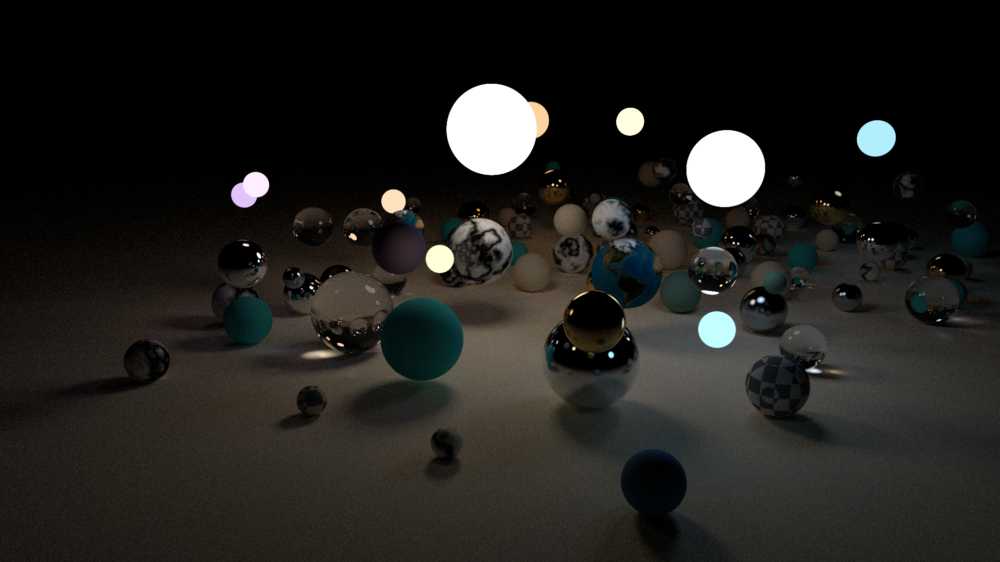
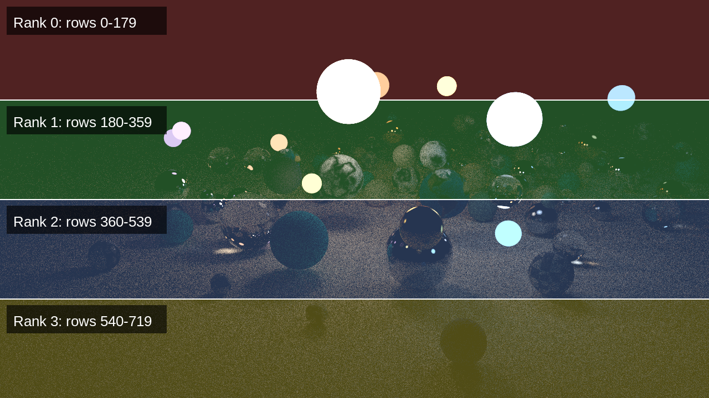
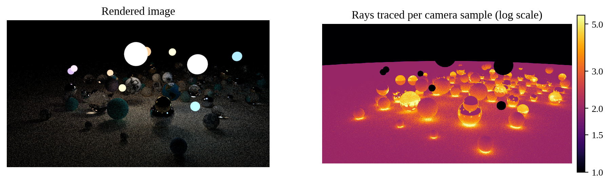
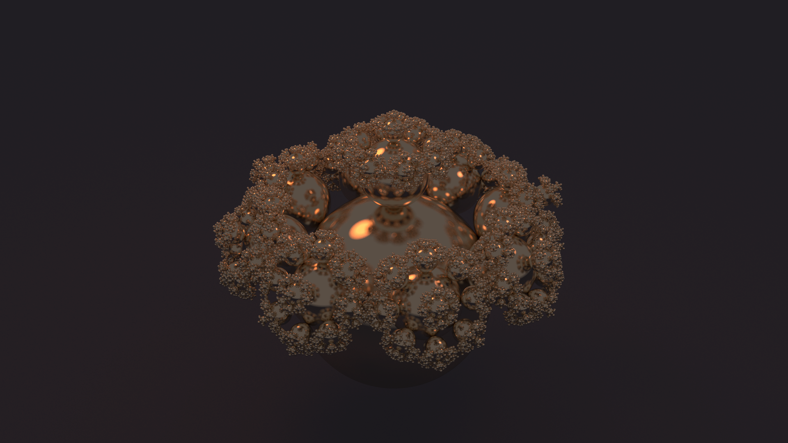
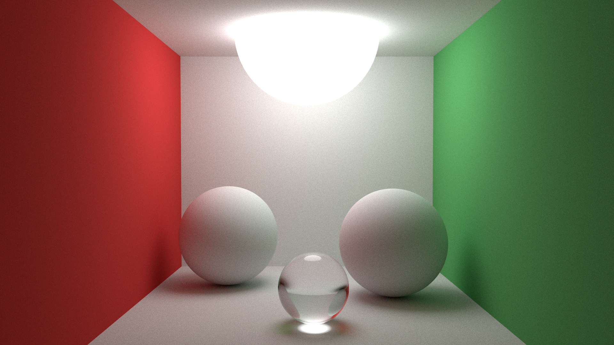
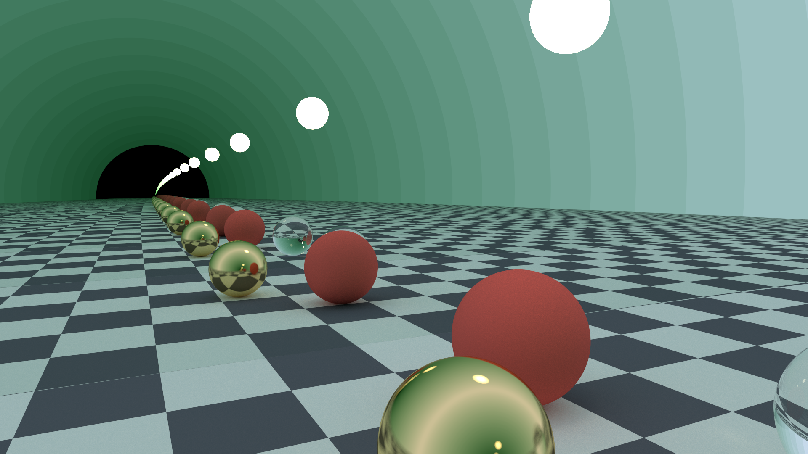
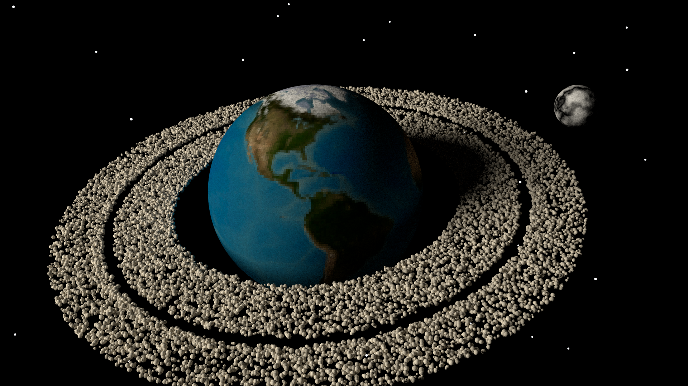
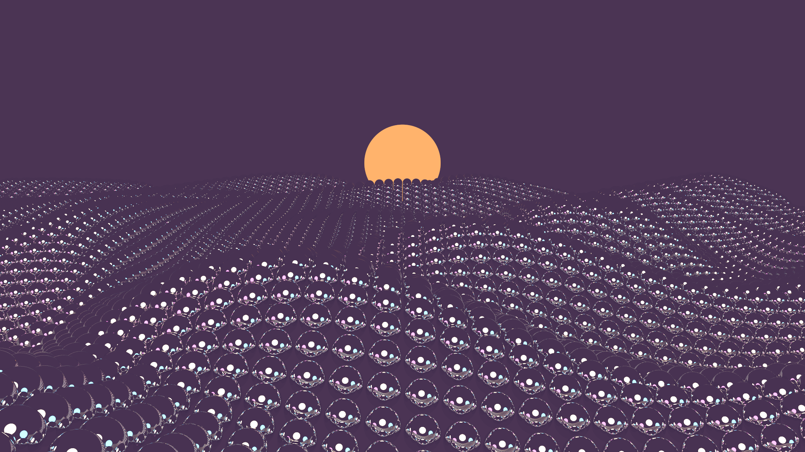
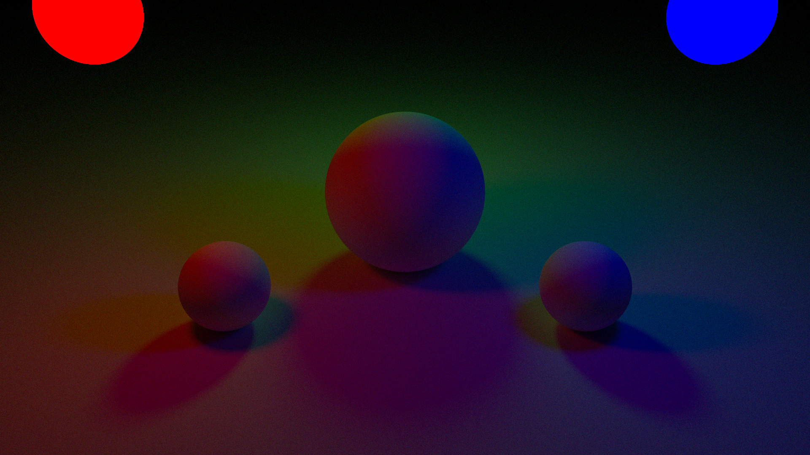
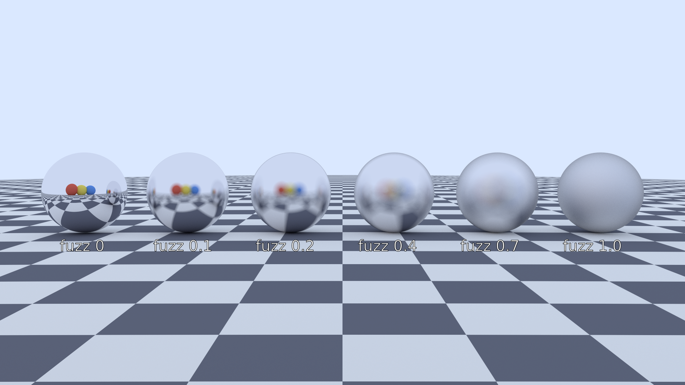

# Parallel Ray Tracing Engine



This is my attempt at parallelising the ray tracer from Peter Shirley's [Ray Tracing in One Weekend](https://raytracing.github.io/) books. I followed the books to build a CPU path tracer in C++20 (spheres, diffuse, metal, glass and light-emitting materials, textures, depth of field and a BVH), then made it run in parallel in three ways: OpenMP threads, MPI processes, and a hybrid of the two.

All versions produce exactly the same image as the serial one, byte for byte. A shared random number generator would make the output depend on which thread got there first, so instead every pixel seeds its own small generator from its position in the image.

## Findings

I benchmarked two scenes at 1280 × 720 with 128 samples per pixel on a laptop with an Intel i5-10310U (4 cores, 8 threads), running each configuration five times and taking the median.

| 4 workers | Scene A (image above) | Scene B (sphereflake) |
|---|---:|---:|
| Serial | 63.76 s | 182.11 s |
| OpenMP, 4 threads | 36.15 s (1.76×) | 99.78 s (1.82×) |
| MPI, 4 processes | 46.63 s (1.37×) | 117.31 s (1.55×) |
| MPI + OpenMP, 2 × 2 | 39.84 s (1.60×) | 99.08 s (1.84×) |

On one machine, threads beat processes. At 4 and 8 workers OpenMP was well ahead of pure MPI, and the fastest hybrid layouts used few processes with many threads: 1 × 8 for scene A (28.22 s) and 2 × 4 for scene B (73.66 s).

The biggest problem was uneven work, not communication. A ray that hits the empty sky stops straight away, while one that bounces between glass and metal keeps going, so some rows of the image cost far more than others. Giving each worker a fixed block of rows leaves some of them idle while the rest finish. Switching OpenMP from static to dynamic scheduling fixed most of this and cut the 4-thread time on scene A by 24.8%. MPI still splits the image into fixed blocks: in one run with 4 processes, the process with the mostly empty top rows finished in 1.6 s and the one with the middle of the scene took 16.1 s.

<p>


</p>

Left: the rows each of 4 MPI processes renders. Right: how many rays each pixel needs. The sky costs one ray per sample; the glass and metal spheres cost four or more.

## Gallery

All of these were rendered with this engine. It only supports spheres, so the floors and walls are just very large spheres.

<table>
<tr>
<td width="50%"><br>Metallic sphereflake: 7,381 metal spheres, each sprouting nine smaller ones. This was the second benchmark scene.</td>
<td width="50%"><br>Sunflower: 900 seeds placed at the golden angle, with petals made from rows of spheres.</td>
</tr>
<tr>
<td><br>Glass marbles with glowing cores on a mirror floor, with depth of field.</td>
<td><br>Chrome, matte and glowing spheres in a softly lit room.</td>
</tr>
<tr>
<td><br>Colour bleeding: the white spheres pick up red and green from light bouncing off the walls.</td>
<td><br>Two facing mirrors. Each copy is one more bounce, and the black end is where the bounce limit runs out.</td>
</tr>
<tr>
<td><br>The Earth texture with a ring of about 20,000 small spheres.</td>
<td><br>A spiral galaxy made of about 30,000 tiny glowing spheres.</td>
</tr>
<tr>
<td><br>10,000 mirror spheres arranged in waves at sunset.</td>
<td><br>Red, green and blue lights. Each shadow takes the colour of the lights that still reach it.</td>
</tr>
<tr>
<td><br>The same glass sphere with refractive index 1.00, 1.33, 1.50, 1.90 and 2.42.</td>
<td><br>Metal going from a perfect mirror to a rough surface.</td>
</tr>
</table>

## Running it

The parallel code is on the `benchmark` branch. You need GCC with C++20 support, OpenMP and Open MPI. ImageMagick is only needed to turn the output into a PNG.

```bash
sudo apt install build-essential openmpi-bin libopenmpi-dev imagemagick
git clone https://github.com/SyedOkashaShoaib/Ray-Tracing-Engine.git
cd Ray-Tracing-Engine
git checkout benchmark
```

Run everything from the repository root, because scene A loads its Earth texture by a relative path. `BENCHMARK_A` or `BENCHMARK_B` picks the scene, and `RT_IMAGE_PATH` sets the output file.

OpenMP:

```bash
g++ -std=c++20 -O3 -fopenmp -I src -DRT_USE_OPENMP -DBENCHMARK_A src/main.cpp -o render_A
OMP_NUM_THREADS=8 OMP_SCHEDULE=dynamic,1 RT_IMAGE_PATH=scene_A.ppm ./render_A
convert scene_A.ppm scene_A.png
```

MPI, and MPI with OpenMP:

```bash
mpic++ -std=c++20 -O3 -I src -DRT_USE_MPI -DBENCHMARK_A src/main.cpp -o render_A_mpi
RT_IMAGE_PATH=scene_A.ppm mpirun -np 4 ./render_A_mpi

mpic++ -std=c++20 -O3 -fopenmp -I src -DRT_USE_MPI -DRT_USE_OPENMP -DBENCHMARK_A src/main.cpp -o render_A_hybrid
OMP_NUM_THREADS=4 RT_IMAGE_PATH=scene_A.ppm mpirun -np 2 ./render_A_hybrid
```

The default is 1280 pixels wide at 128 samples per pixel. For a bigger, cleaner image, add for example `-DRT_BENCH_WIDTH=1920 -DRT_BENCH_SPP=1024` when compiling. Doubling the samples roughly doubles the render time.

## Repository layout

| Branch | Contents |
|---|---|
| `master` | the serial engine, this README and the images in `renders/` |
| `parallel_rte` | the parallel engine (OpenMP, MPI and hybrid) on its own |
| `benchmark` | the parallel engine plus timing, benchmark scripts and the gallery scenes |

```text
src/        the engine: camera, materials, textures, BVH and scenes
scripts/    benchmark runner and experiment scripts      (benchmark branch)
showcase/   the programs that render the gallery images  (benchmark branch)
renders/    images used in this README                   (master)
```

## What's next

I intend to keep expanding this project and turn it into a proper ray tracing engine, going beyond the spheres-only renderer from the books.

Based on Peter Shirley's *Ray Tracing in One Weekend* series. Image loading uses [stb_image](https://github.com/nothings/stb).
