<div align="center">


# Parallel Ray Tracing Engine

**A CPU path tracer in C++20, parallelised four ways — and every one of them produces the exact same image, down to the last byte.**


[Gallery](#-gallery) · [How it's parallelised](#-how-its-parallelised) · [Results](#-results) · [Build & run](#-build--run) · [Showcase renders](#-showcase-renders)

</div>

---

## ✨ At a glance

<table>
<tr>
<td align="center"><h3>117,964,800</h3>camera rays per benchmark image</td>
<td align="center"><h3>7,384</h3>spheres in the sphereflake scene</td>
<td align="center"><h3>4</h3>execution modes from one code base</td>
<td align="center"><h3>250</h3>timed runs, all byte-identical</td>
</tr>
</table>

Built by following Peter Shirley's [*Ray Tracing in One Weekend*](https://raytracing.github.io/) series, then taken further: the same renderer runs **serially**, with **OpenMP** threads, with **MPI** processes, and as an **MPI + OpenMP hybrid**, and we measured how each one scales.

**Features:** diffuse, metal (with fuzz), glass (refraction, total internal reflection, Schlick reflectance) and light-emitting materials · checker, Perlin-marble and image textures · depth of field · bounding volume hierarchy · deterministic per-pixel random numbers.

---

## 🖼 Gallery

<table>
<tr>
<td width="50%"><br><sub><b>Material Garden</b> (benchmark scene A) — 106 spheres, every material type, lit only by glowing spheres.</sub></td>
<td width="50%"><br><sub><b>Metallic Sphereflake</b> (benchmark scene B) — 7,381 recursively placed metal spheres; each sphere sprouts nine smaller ones.</sub></td>
</tr>
<tr>
<td>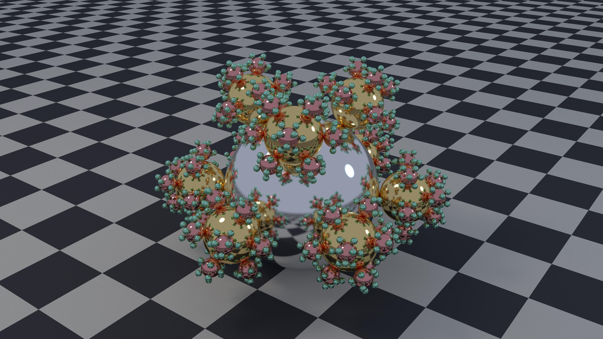<br><sub><b>Rainbow sphereflake</b> — three levels of recursion (820 spheres), a different metal colour at each level, on a checkered floor. 4K.</sub></td>
<td>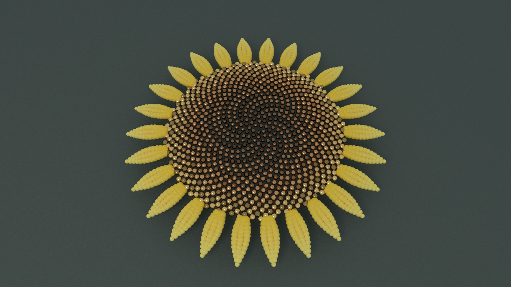<br><sub><b>Golden-spiral sunflower</b> — 900 seeds placed at the golden angle (137.5°) and 26 petals built from rows of spheres.</sub></td>
</tr>
<tr>
<td>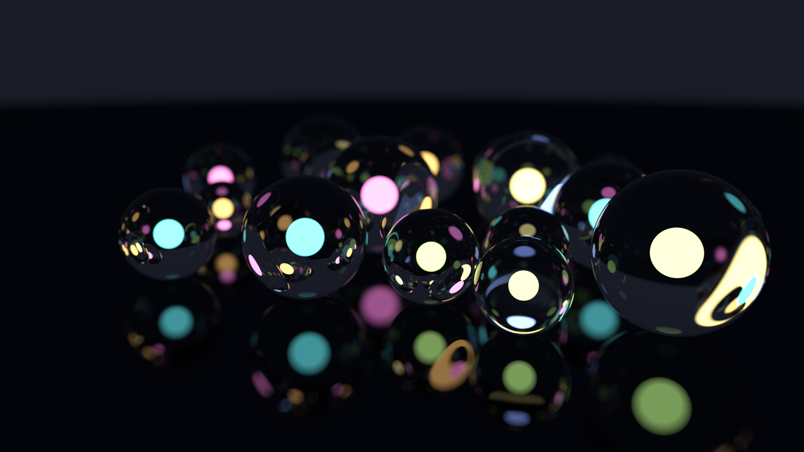<br><sub><b>Glowing marbles</b> — glass marbles with glowing cores on a mirror floor; the glass bends and magnifies each core, and depth of field blurs the back.</sub></td>
<td>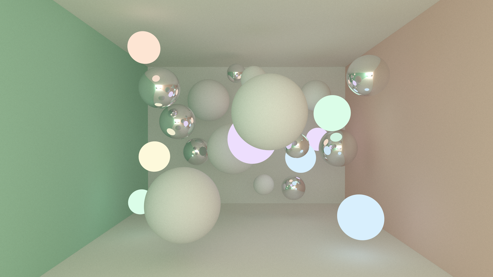<br><sub><b>Pastel room</b> — chrome, matte and softly glowing spheres; the glowing spheres tint the walls around them.</sub></td>
</tr>
<tr>
<td><br><sub><b>Colour bleeding</b> — the white spheres turn red and green from light bouncing off the walls. The "walls" are spheres of radius 1000.</sub></td>
<td><br><sub><b>Mirror corridor</b> — two parallel mirrors; every copy is one more bounce, until the bounce limit turns the end of the tunnel black.</sub></td>
</tr>
</table>

<details>
<summary><b>More renders (click to expand)</b></summary>
<br>
<table>
<tr>
<td width="50%"><br><sub><b>Ringed planet</b> — the Earth texture, a ring of about 20,000 icy spheres and a marble moon, lit by one star.</sub></td>
<td width="50%">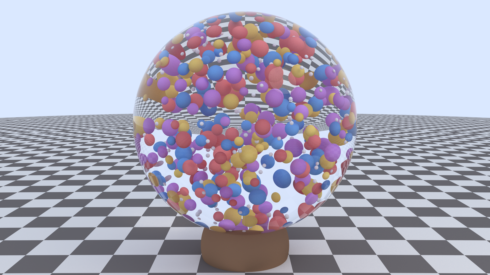<br><sub><b>Snow globe</b> — about 600 coloured spheres inside a water-filled globe (index 1.33), bent and magnified by the water.</sub></td>
</tr>
<tr>
<td>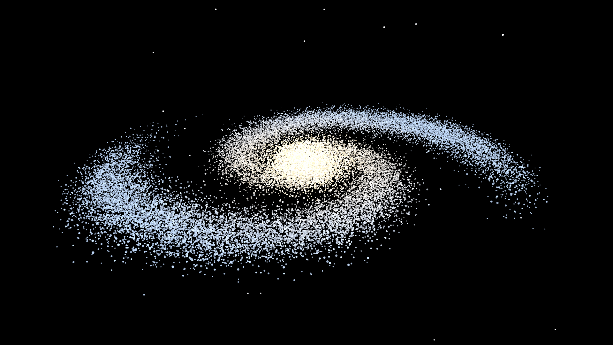<br><sub><b>Spiral galaxy</b> — about 30,000 tiny glowing spheres in a warm core and two blue-white arms.</sub></td>
<td><br><sub><b>Chrome ocean</b> — 10,000 mirror spheres on two overlapping waves at sunset, each reflecting its neighbours.</sub></td>
</tr>
<tr>
<td><br><sub><b>Light mixing</b> — red, green and blue lights; each shadow is the colour of the lights that still reach it.</sub></td>
<td>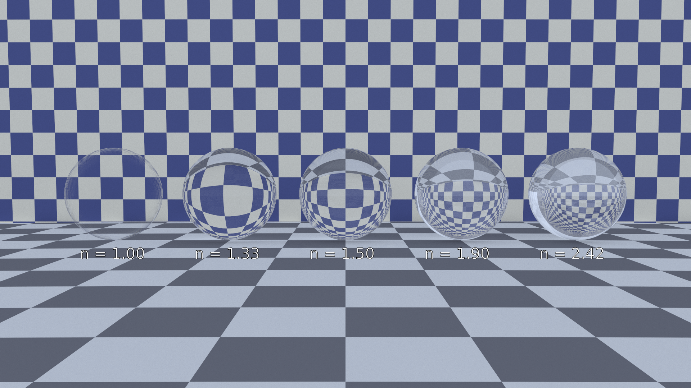<br><sub><b>Refraction</b> — the same glass sphere with index 1.00 (invisible), 1.33 (water), 1.50 (glass), 1.90 and 2.42 (diamond).</sub></td>
</tr>
<tr>
<td><br><sub><b>Metal fuzz</b> — from a perfect mirror (0) to rough metal (1.0).</sub></td>
<td>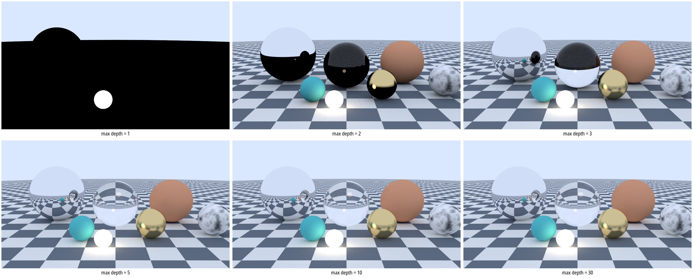<br><sub><b>Bounce by bounce</b> — the same scene with a limit of 1, 2, 3, 5, 10 and 30 bounces.</sub></td>
</tr>
<tr>
<td colspan="2">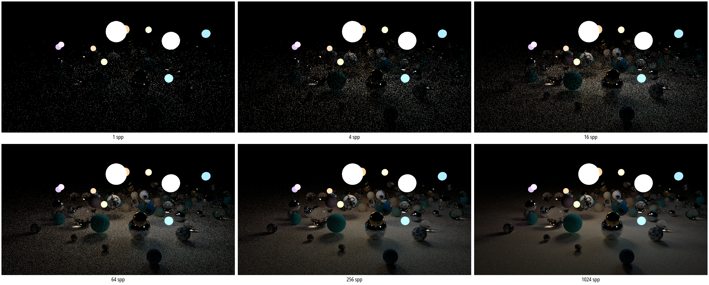<br><sub><b>Samples per pixel</b> — scene A at 1, 4, 16, 64, 256 and 1,024 samples per pixel. Each step is four times the work and roughly halves the noise.</sub></td>
</tr>
</table>
</details>

> [!NOTE]
> The engine knows only one shape: the sphere. Floors, walls and ceilings are spheres so large that they are flat to within a fraction of a pixel.

---

## 🧠 How it's parallelised

Every pixel's colour depends only on the scene and its own rays, so pixels can be computed in any order, by any worker. The unit of work is **one row of pixels**.

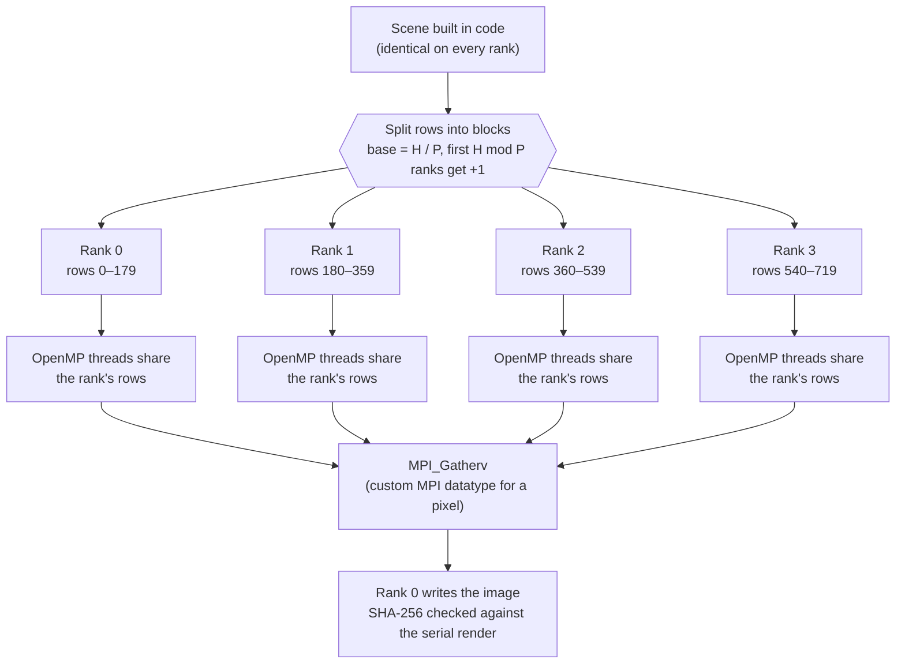

| Mode | What runs in parallel | Key code |
|---|---|---|
| **Serial** | nothing — the baseline for speed *and* correctness | `renderRowsInitialized()` |
| **OpenMP** | threads share the row loop of one process | `#pragma omp parallel for schedule(runtime)` |
| **MPI** | separate processes each render a block of rows | row split + `MPI_Gatherv` + `MPI_Reduce(MPI_MAX)` |
| **Hybrid** | MPI splits rows across ranks, OpenMP threads inside each | `MPI_Init_thread(MPI_THREAD_FUNNELED)` |

> [!IMPORTANT]
> **Same image, every time.** A shared random number generator would make each pixel depend on thread timing. Instead every pixel seeds its own tiny SplitMix64-style generator from its position in the image, so a pixel gets the same random numbers whichever thread or rank renders it. Every benchmark run's SHA-256 hash was checked against the serial render, and all 250 matched.

---

## 📊 Results

Measured on a laptop with an Intel Core i5-10310U (4 cores, 8 hardware threads), 1280 × 720, 128 samples per pixel, up to 30 bounces, five runs per configuration (median shown).

<div align="center">
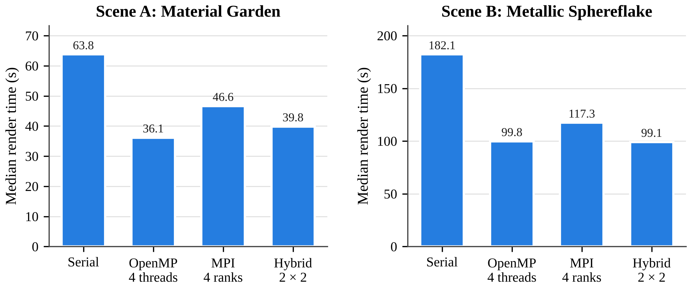
</div>

| Four workers each | Scene A | Speedup | Scene B | Speedup |
|---|---:|---:|---:|---:|
| Serial | 63.76 s | 1.00× | 182.11 s | 1.00× |
| OpenMP, 4 threads | 36.15 s | **1.76×** | 99.78 s | 1.82× |
| MPI, 4 ranks | 46.63 s | 1.37× | 117.31 s | 1.55× |
| Hybrid, 2 × 2 | 39.84 s | 1.60× | 99.08 s | **1.84×** |

$$S(p)=\frac{T(1)}{T(p)} \qquad E(p)=\frac{S(p)}{p}$$

<details>
<summary><b>Scaling, hybrid layouts and scheduling (click to expand)</b></summary>

<br>

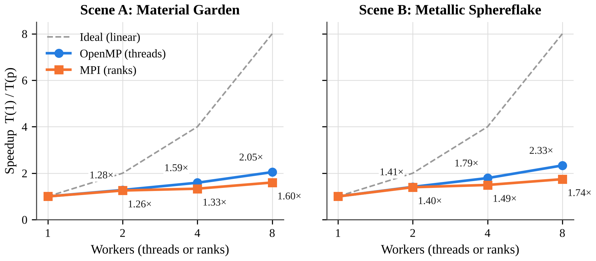

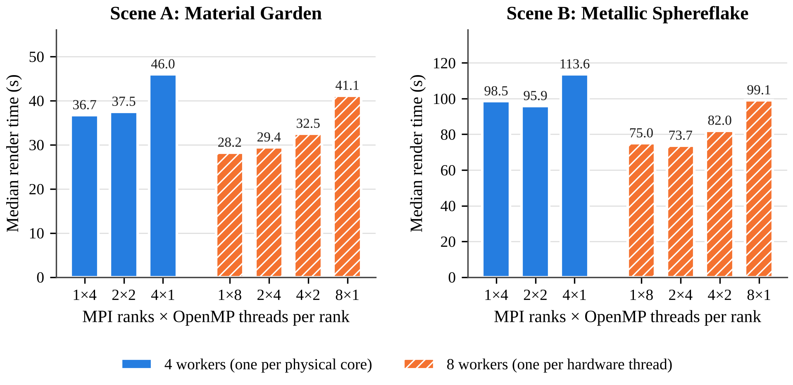

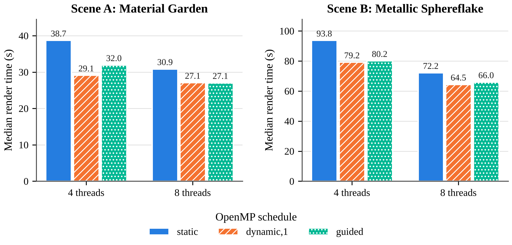

- **Few ranks, many threads wins.** With 8 workers, 1 × 8 (Scene A, 28.22 s) and 2 × 4 (Scene B, 73.66 s) were fastest; pure MPI (8 × 1) was slowest.
- **Scheduling matters.** Switching OpenMP from `static` to `dynamic,1` cut the four-thread render time by 24.8% on Scene A.

</details>

### The big lesson: not all rows are equal

<div align="center">

</div>

<div align="center">

</div>

With four MPI ranks, every rank gets 180 rows, but not the same work: in a separate diagnostic run at 64 samples per pixel, rank 0 (mostly black sky) finished in **1.6 s** while rank 2 (the middle of the scene) took **16.1 s**.

Rays that hit empty sky stop after one test; rays that bounce between glass, metal and the floor can take dozens. Giving each worker a fixed block of rows therefore leaves some workers idle while others still have expensive rows to finish. Dynamic scheduling fixes this within a process; balancing rows *across* MPI ranks is the natural next step.

---

## 🔨 Build & run

The parallel engine lives on the `parallel_rte` branch; the `benchmark` branch has the same engine plus the size/quality options, benchmark scripts and showcase programs, so start there:

```bash
git clone https://github.com/SyedOkashaShoaib/Ray-Tracing-Engine.git
cd Ray-Tracing-Engine
git checkout benchmark
```

**Requirements:** GCC with C++20, OpenMP, and Open MPI (`sudo apt install build-essential openmpi-bin libopenmpi-dev`). Run from the repository root: Scene A loads its Earth texture by a relative path.

<details open>
<summary><b>OpenMP (fastest on one machine)</b></summary>

```bash
g++ -std=c++20 -O3 -fopenmp -I src -DRT_USE_OPENMP -DBENCHMARK_A src/main.cpp -o render_A
OMP_NUM_THREADS=8 OMP_SCHEDULE=dynamic,1 RT_IMAGE_PATH=scene_A.ppm ./render_A
```
</details>

<details>
<summary><b>MPI and hybrid</b></summary>

```bash
# MPI: 4 processes
mpic++ -std=c++20 -O3 -I src -DRT_USE_MPI -DBENCHMARK_A src/main.cpp -o render_A_mpi
RT_IMAGE_PATH=scene_A.ppm mpirun -np 4 ./render_A_mpi

# Hybrid: 2 processes × 4 threads
mpic++ -std=c++20 -O3 -fopenmp -I src -DRT_USE_MPI -DRT_USE_OPENMP -DBENCHMARK_A src/main.cpp -o render_A_hybrid
OMP_NUM_THREADS=4 RT_IMAGE_PATH=scene_A.ppm mpirun -np 2 ./render_A_hybrid
```
</details>

<details>
<summary><b>Choosing size and quality</b></summary>

| Macro / variable | Meaning | Default |
|---|---|---|
| `BENCHMARK_A` / `BENCHMARK_B` | scene to render | — |
| `RT_BENCH_WIDTH` | image width (height follows at 16:9) | 1280 |
| `RT_BENCH_SPP` | samples per pixel | 128 |
| `RT_IMAGE_PATH` | output file (PPM) | standard output |

```bash
g++ -std=c++20 -O3 -fopenmp -I src -DRT_USE_OPENMP -DBENCHMARK_B \
    -DRT_BENCH_WIDTH=1920 -DRT_BENCH_SPP=1024 src/main.cpp -o render_B
RT_IMAGE_PATH=scene_B.ppm OMP_NUM_THREADS=8 OMP_SCHEDULE=dynamic,1 ./render_B
convert scene_B.ppm scene_B.png     # ImageMagick
```
</details>

> [!TIP]
> To render every showcase scene in one go (with cool-down pauses for the CPU), run `bash showcase/render_overnight.sh`.

> [!TIP]
> Noise falls with the square root of the sample count: 4× the samples halves the noise. Preview at 64 samples per pixel, then render the final image at 512–1024.

---

## 🌈 Showcase renders

The [`showcase/`](https://github.com/SyedOkashaShoaib/Ray-Tracing-Engine/tree/benchmark/showcase) folder on the `benchmark` branch holds 18 extra programs, each demonstrating one idea. They reuse the engine unchanged; run them from the repository root. Each `render.sh` lists its settings at the top.

| | Concept | Command |
|---|---|---|
| 01 | Bounce depth | `bash showcase/01_bounce_depth/render.sh` |
| 02 | Samples per pixel and noise | `bash showcase/02_spp_convergence/render.sh` |
| 03 | Which MPI rank rendered which rows | `bash showcase/03_rank_partition/render.sh` |
| 04 | Cost heatmap and load imbalance | `bash showcase/04_cost_heatmap/render.sh` |
| 05 | Refraction index sweep | `bash showcase/05_refraction_sweep/render.sh` |
| 06 | Metal fuzz sweep | `bash showcase/06_fuzz_sweep/render.sh` |
| 07 | Mirror corridor | `bash showcase/07_mirror_corridor/render.sh` |
| 08 | Colour bleeding | `bash showcase/08_colour_bleeding/render.sh` |
| 09 | Coloured light mixing | `bash showcase/09_rgb_light_mixing/render.sh` |
| 10 | Spiral galaxy | `bash showcase/10_galaxy/render.sh` |
| 11 | Chrome sphere ocean | `bash showcase/11_chrome_ocean/render.sh` |
| 12 | Ringed planet | `bash showcase/12_ringed_planet/render.sh` |
| 13 | Golden-spiral sunflower | `bash showcase/13_golden_spiral/render.sh` |
| 14 | Glowing marbles | `bash showcase/14_glowing_marbles/render.sh` |
| 15 | Snow globe | `bash showcase/15_snow_globe/render.sh` |
| 16 | DNA helix | `bash showcase/16_dna_helix/render.sh` |
| 17 | Apollonian sphere packing | `bash showcase/17_apollonian_packing/render.sh` |
| 18 | Pastel room | `bash showcase/18_pastel_room/render.sh` |

---

## 🗂 Repository layout

| Branch | Contents |
|---|---|
| `master` | the serial engine, this README and the rendered images in [`renders/`](renders/) |
| `parallel_rte` | the parallel engine (OpenMP, MPI, hybrid) only |
| `benchmark` | the parallel engine plus timing, benchmark scripts and the [`showcase/`](https://github.com/SyedOkashaShoaib/Ray-Tracing-Engine/tree/benchmark/showcase) programs |

```text
src/            the engine: camera, materials, textures, BVH, scenes
scripts/        benchmark runner and experiment drivers   (benchmark branch)
showcase/       the 18 showcase programs                   (benchmark branch)
renders/        renders and charts used in this README     (master)
```

---

<div align="center">

**Parallel and Distributed Computing · Fall 2026 · FAST-NUCES Karachi**

Kumail Ali (23K-0791) · Syed Okasha (23K-0850) · Arsh Omar Mufti (23K-0648)

<sub>Built on Peter Shirley's <i>Ray Tracing in One Weekend</i> series · images via <a href="https://github.com/nothings/stb">stb_image</a></sub>

</div>
